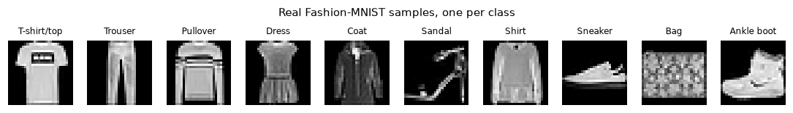
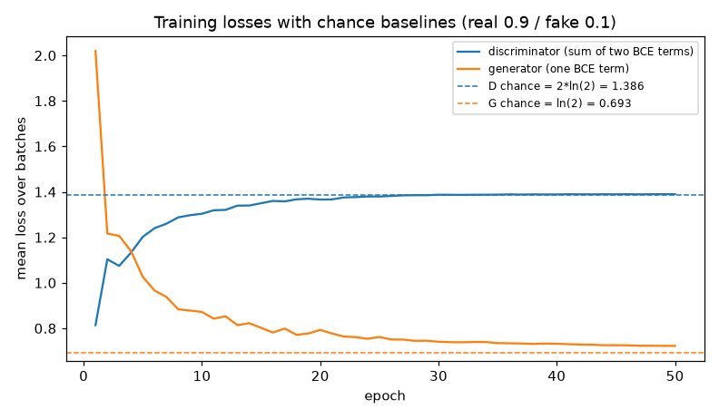
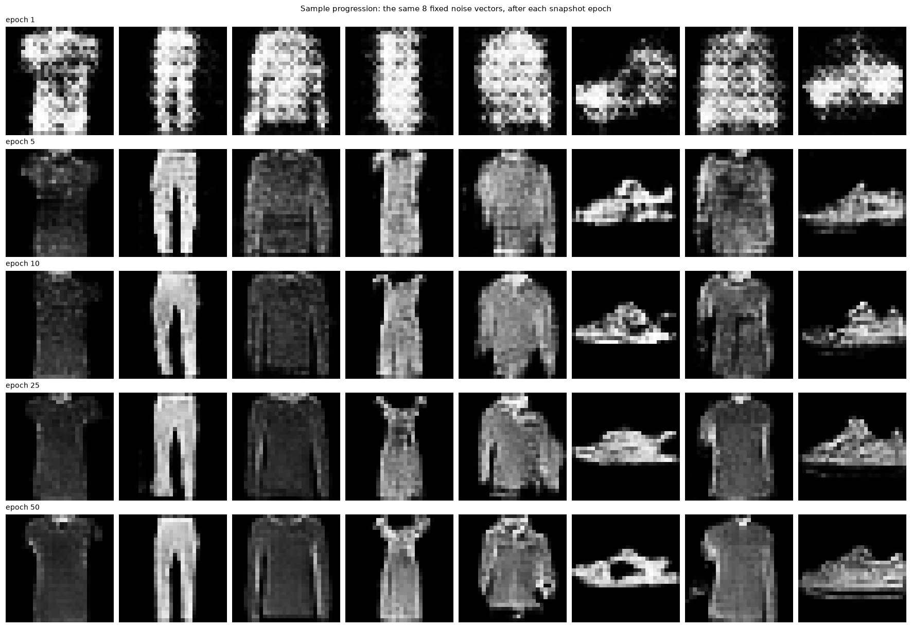
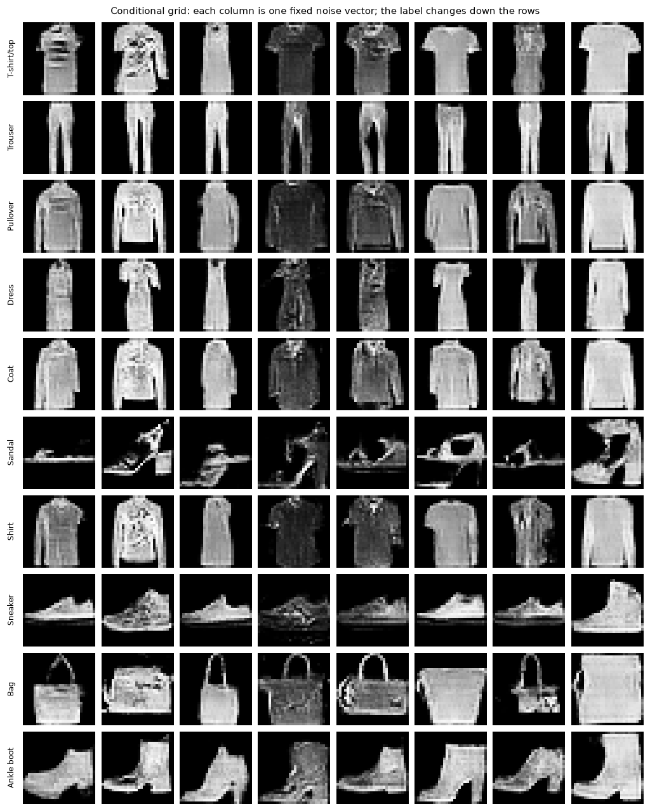
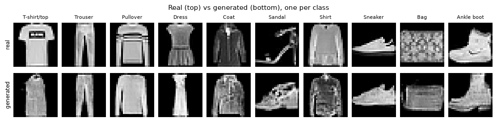
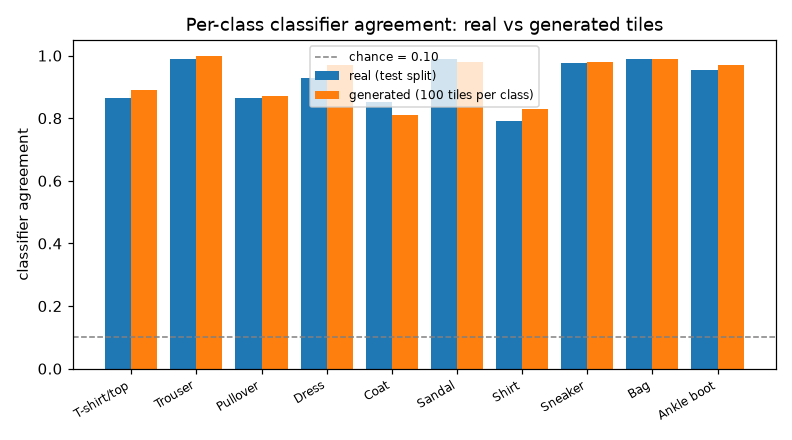
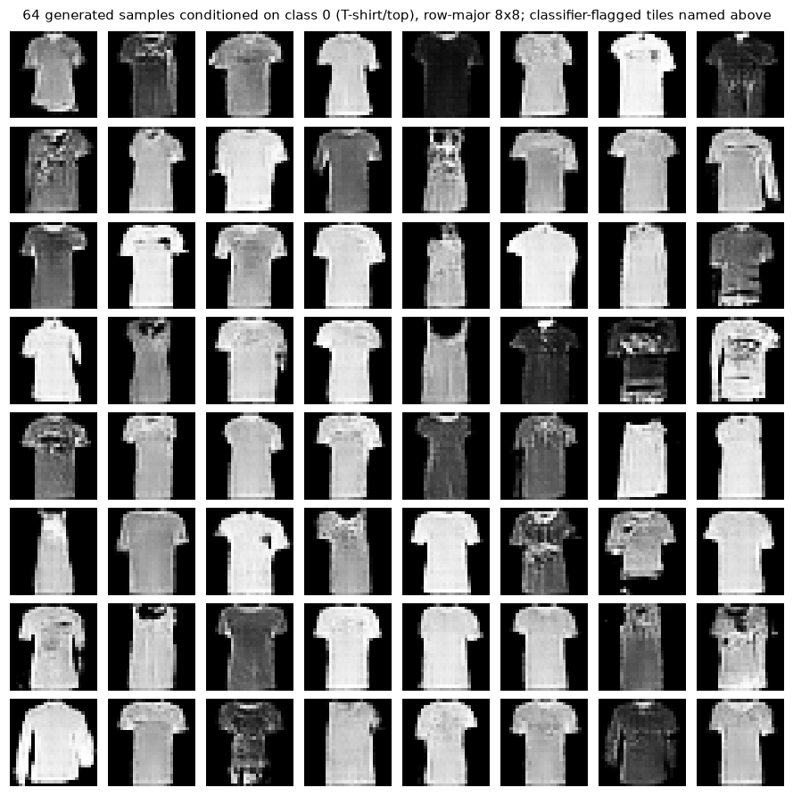

# Generating Clothing Images with a Conditional Deep Convolutional Generative Adversarial Network

Generative AI Applications Analysis Report

Author: Francisco Mateus

Dataset: Fashion-MNIST (Xiao et al., 2017)

## Overview

This project trained a conditional Deep Convolutional Generative Adversarial Network (DCGAN) to generate `28x28` grayscale clothing images from the Fashion-MNIST dataset (Xiao et al., 2017). The model is conditioned on one of ten garment labels. The project trained a generator and discriminator pair, plus a separate small classifier that checks whether generated images match their requested labels. The classifier assigned the requested label to `0.9008` of generated images, compared with `0.9074` of real test images. The two scores are close, which shows that the labels largely control the generated content. These numbers show that an image depicts the right type of item. They do not show that the image is realistic.

## Dataset or Prompt Description

The data comes from the Fashion-MNIST dataset (Xiao et al., 2017), available at https://github.com/zalandoresearch/fashion-mnist. It contains grayscale images of clothing products with class annotations:

- total images: `70,000`
- class labels: `10` garment categories (T-shirt/top, Trouser, Pullover, Dress, Coat, Sandal, Shirt, Sneaker, Bag, Ankle boot)
- training images: `60,000` (`6,000` per class)
- test images: `10,000` (`1,000` per class)
- image size: `28x28` pixels, grayscale
- license: MIT, attributed to the upstream Fashion-MNIST repository, as recorded in `DATASET.md`

Figure 1: one real Fashion-MNIST sample from each of the ten classes.

Generating a class means capturing what defines it: outline, contrast, and shading. At `28x28` grayscale this is hard for similar classes. The evaluation classifier most often confused real T-shirt/top images with Shirt, and the generated samples show the same ambiguity (see Class agreement). Even so, the ten categories remain recognizable at this resolution, which makes the dataset practical for visual inspection of generated samples.

The training images were divided between the project's two models. The generator and discriminator trained on the full `60,000`-image training set. The evaluation classifier used a stratified pool of `5,000` images per class (equal numbers of each class), holding out the remaining `1,000` images per class:

- classifier training: `50,000` images, used to update classifier weights
- classifier validation: `10,000` images, used to monitor per-epoch accuracy (no gradient updates, no model selection)
- test set: the original `10,000`-image test set, used only after classifier training (test accuracy and Fréchet features), never for model selection

Data handling and parameters:

- pixel values scaled to the range `[-1, 1]`, matching the generator's `Tanh` output
- offline-first loading from the repository's `data/` directory, with the notebook verifying the four archive checksums against `DATASET.md` before training (`download=True` is a documented fallback only)
- random seed `42` for the split, GAN training, and fixed visualization inputs; evaluation noise uses seed `43` (`SEED + 1`), which is unrelated to the seed-`43` training run in the seed-sensitivity section

## Model Design and Training Approach

### Generator and discriminator architecture

Both networks follow the DCGAN guidelines proposed by Radford et al. (2016), which describe architectural choices intended to support stable GAN training.

The generator starts from a latent vector of 100 random numbers for each image. A dense projection reshapes this vector into a `7x7` feature grid. Two transposed convolutions (`ConvTranspose2d`, kernel 4, stride 2) then double the spatial size at each step, from `7x7` to `14x14` to `28x28`. A final 3x3 transposed convolution (stride 1) refines the `28x28` output, and a `Tanh` layer maps the pixel values into the `[-1, 1]` range of the normalized input data.

Batch normalization follows the generator's dense projection and both upsampling layers. In the discriminator, it follows the second convolution. It stabilizes training by normalizing activations as they pass through each network. Following the DCGAN guidelines, it is omitted from the generator's output layer and the discriminator's first layer.

In the discriminator, two strided convolutions reduce the image resolution, and LeakyReLU activations with a negative slope of 0.2 let small gradients pass through negative inputs, as the DCGAN guidelines recommend. The last feature map (`128` channels at `7x7`) is flattened and passed through a single linear unit, `Linear(128*7*7, 1)`, which maps its `6,272` values to one real-or-fake score. The layer has `6,272` weights and one bias. This matches the DCGAN description of a flattened final convolution feeding a single output.

### Conditional generation

Following Mirza and Osindero (2014), I made the GAN conditional so that it generates images of a requested Fashion-MNIST category rather than random unlabeled samples. Class labels are supplied to both networks. The generator uses the label to shape what it produces, and the discriminator uses it to judge whether an image matches its requested class.

In the generator, the requested class label is mapped to a 16-dimensional learned embedding: a trainable vector of numbers that represents the class. Unlike a one-hot encoding, which only identifies the class, an embedding can capture relationships between classes. The embedding dimension was fixed at 16 and not tuned. The ablation budget went to the label-smoothing variant instead, so that each experiment changed only one factor.

The label embedding is concatenated with the 100-dimensional noise vector, giving a 116-dimensional input. A dense layer projects this input into a `7x7x256` feature volume (12,544 values), which is the starting point for image generation. This layer has `1,467,648` parameters (116 × 12,544 weights plus 12,544 biases), about 68.3% of the generator's `2,149,409` parameters.

In the discriminator, a separate label embedding maps each class to a `28x28` grid of values. This grid is concatenated with the image as a second input channel, so the convolutional layers process the image and its label together from the first layer. The discriminator can therefore judge both whether an image looks real and whether it matches its requested class. Because the generator is penalized when its output fails this check, it receives a training signal to respect the requested label.

### Training configuration

Training alternates between two updates, both scored with `BCEWithLogitsLoss` applied to raw logits (the numerically stable form of the standard yes/no loss). In the discriminator update, the network is trained on a batch of real images with a smoothed target of `0.9` and a batch of generated images with a smoothed target of `0.1`. In the generator update, the generator is trained to make the discriminator score its images as real, using the hard target of `1`.

I used two-sided label smoothing, with targets of `0.9` for real images and `0.1` for generated images, to keep the discriminator from becoming overconfident and weakening the learning signal for the generator. Salimans et al. (2016, Section 3.4) instead recommend one-sided smoothing, in which only the real target is smoothed and the generated target stays at `0`. Both approaches are reasonable, so I compared them empirically (see the label-smoothing ablation).

Both networks were trained with Adam, a learning rate of `2e-4`, and betas of `(0.5, 0.999)`, following the optimizer settings of Radford et al. (2016). Training took approximately `8.9` seconds per epoch.

Beyond the headline run, I trained three additional models under the same configuration, each for `50` epochs. Two used different random seeds (`43` and `44`) to assess sensitivity to initialization, and one used one-sided label smoothing to isolate the effect of that choice.

| Parameter | Configuration |
|---|---|
| Model | Conditional DCGAN |
| Dataset | Fashion-MNIST |
| Epochs | 50 |
| Batch size | 128 |
| Latent dimension | 100 |
| Label embedding | 16 |
| Optimizer | Adam |
| Learning rate | 0.0002 |
| Betas | (0.5, 0.999) |
| Random seed | 42 |
| Sensitivity seeds | 43 and 44 |
| Smoothing (headline run) | two-sided (0.9 / 0.1) |
| Hardware | NVIDIA GeForce RTX 4080 Laptop |
| Training time | 444 seconds |

### BatchNorm and the generation protocol

Generating images in training mode raises a consistency problem. In training mode, the generator's BatchNorm layers compute statistics from the current batch, so the same noise vector and class label can produce different pixels depending on which other samples are in the batch.

To measure this effect, I generated images from the same fixed noise vectors and class labels under six combinations of model mode (training or evaluation) and batch composition (mixed-class, single-class, or batch size 1), using `1,000` generated images per combination. Five combinations produced results. The sixth, training mode with a batch size of 1, failed: the generator applies `BatchNorm1d` to the projected feature vector, and in training mode PyTorch rejects a batch containing a single sample because it cannot compute batch statistics from one.

Training-mode generation therefore depends on batch composition and cannot produce single samples, so I used evaluation mode for all image generation. In this mode, BatchNorm uses the running statistics accumulated during training instead of statistics from the current batch, which removes the dependence on batch composition. Every generated sample in the notebook, including the failure strip, uses this setting. The measured comparison is in the generation protocol results.

## Output Evaluation and Interpretation

### Evaluation overview

The notebook produces seven figures. The real-image reference strip is in the dataset section, and the other six are in this section.

| Measurement | Result | What it evaluates |
|---|---:|---|
| Generated classifier agreement | 0.9008 | Class agreement |
| Real test agreement | 0.9074 | Classifier agreement on real images |
| Generated Fréchet distance | 21.0 | Distribution difference in classifier feature space |
| Real-vs-real reference distance | 1.3 | Reference distance in the same feature space |
| Macro diversity ratio | 0.87 | Generated versus real intra-class diversity |
| Agreement across seeds 42/43/44 | 0.9008 / 0.9020 / 0.8843 | Seed sensitivity of the headline run |
| One-sided smoothing agreement | 0.9100 | Ablation variant |

### Training behavior

Figure 2: mean discriminator and generator losses per epoch, with their chance baselines.

The discriminator and generator losses use different numbers of binary cross-entropy (BCE) terms, so their chance baselines differ. The discriminator loss sums two BCE terms, so a coin-flip prediction gives `2 × ln(2) ≈ 1.386`. The generator loss has one term, so its chance baseline is `ln(2) ≈ 0.693`. Figure 2 shows both baselines.

The discriminator loss started at `0.814` after the first epoch, below its chance baseline. It rose to `1.30` at epoch 10 and `1.37` at epoch 18. Over the final twenty epochs, it stayed between `1.387` and `1.390`, close to and slightly above chance.

The generator loss fell from `2.019` to `0.872` at epoch 10 and then declined slowly toward its `0.693` baseline. It leveled off at `0.723` from epoch 47 onward.

By the end, both losses were close to their chance baselines and neither diverged. Near-chance losses do not establish that the two networks reached a stable equilibrium or that the generated images match the real data distribution.

### Qualitative evaluation

Figure 3: the same eight fixed (noise, label) pairs, rendered after snapshot epochs 1, 5, 10, 25, and 50.

At epoch 1, the images are mostly noise, but rough garment silhouettes are already visible. By epoch 5, the trousers, the sandal, and the sneaker are recognizable. From epochs 10 to 50, sleeves, soles, and straps become more defined. Each column keeps its garment identity across snapshots, so later epochs refine existing shapes rather than change them.

Figure 4: class-conditioned grid. Each column is one fixed noise vector, and the label changes down the rows.

The grid shows class control most clearly for Trouser, Bag, and the three footwear classes (Sandal, Sneaker, Ankle boot). Within each of these rows the noise changes shading and detail while the garment category stays fixed. The style still varies within a row: some sneakers are high-tops, some sandals are flat rather than heeled, and not every bag has a handle.

Class control is weaker for the five upper-body classes (T-shirt/top, Pullover, Dress, Coat, Shirt). Within each column, these rows look similar, so the noise vector seems to shape the garment more than the label does. This fits the T-shirt/top and Shirt confusion measured below. Overall, the label changes the output as expected for a conditional GAN (Mirza & Osindero, 2014), with the strongest effect on classes whose shapes are clearly different.

Figure 5: one real (top) and one generated (bottom) sample per class.

In these examples, the generated silhouettes keep recognizable features of their classes, such as two trouser legs and the shaft of the boot. The quality gap is also visible: the generated images are grainier, have flatter grayscale values, and contain less fine texture than the real images. The generated sandal is bulkier and lower than the real stiletto-style sandal, and the generated bag lacks the woven pattern of the real one.

### Class agreement

The grids give the visual side of the evaluation. For a quantitative check, I measured class agreement with a separate classifier, following Odena et al. (2017), who ask whether generated images are recognized as their intended classes.

I trained a small CNN on a stratified pool of `50,000` real training images. It has two convolution blocks, a dense head, and `421,834` parameters.

Validation accuracy, measured on a held-out split of `10,000` real images, was tracked after each epoch. It reached `0.9019` after 1 epoch and `0.9199` after 10 epochs, and ranged from `0.917` to `0.925` over the last five epochs. This plateau suggests validation performance has stabilized, although ten epochs and one seed do not establish convergence. The test split was evaluated once, after training: the classifier read `0.9074` of the `10,000` test images correctly.

I then generated `1,000` images per class (`10,000` in total) with the trained generator, using evaluation seed `43` and the evaluation-mode protocol. The classifier scored each generated image against its requested class. I call this *class agreement*: does a classifier trained on real data read the image as the class that was requested? It is a narrow check that says nothing about realism or variety. The next two measurements address those.

Figure 6: per-class classifier agreement for real test images and generated images. The dashed line represents chance agreement (`0.10`).

The classifier assigned the requested label to `0.9008` of generated images. Its accuracy on the real test split was `0.9074`, so the generated images scored `0.0066` below the real ones. This difference is within the expected sampling variability at these sample sizes. The per-class results are:

| Class | Generated | Real test |
|---|---:|---:|
| T-shirt/top | 0.75 | 0.81 |
| Trouser | 1.00 | 0.98 |
| Pullover | 0.80 | 0.80 |
| Dress | 0.91 | 0.88 |
| Coat | 0.90 | 0.91 |
| Sandal | 0.96 | 0.97 |
| Shirt | 0.78 | 0.79 |
| Sneaker | 0.93 | 0.96 |
| Bag | 1.00 | 0.98 |
| Ankle boot | 1.00 | 0.98 |

T-shirt/top has the largest gap: `0.75` for generated images against `0.81` for real images, a difference of `0.06`. The standard error of the difference between two estimates at `1,000` images each is about `0.02`, so this gap is larger than sampling noise alone would explain.

The confusion counts show where the T-shirt/top errors go:

| Classifier predicted | Real T-shirt/top (1,000) | Generated T-shirt/top (1,000) |
|---|---:|---:|
| T-shirt/top (correct) | 813 | 752 |
| Shirt | 135 | 167 |
| Pullover | 20 | 32 |
| Dress | 16 | 35 |
| Other classes | 16 | 14 |

Both columns share the same main confusion, Shirt, but the generated images have a higher Shirt rate (`0.17` against `0.14`). Real T-shirt/top images were already hard for the classifier: it mislabeled `187` of the `1,000` real test images (`0.19`). The evidence does not show whether the extra Shirt errors come from the generator or from the classifier's decision boundary. The pattern is consistent with ambiguity already present in the dataset, but it does not rule out that the generator adds its own weaknesses.

### Distribution similarity

Class agreement does not show how closely the generated images match the real ones as a whole, or how much they vary within each class. Two further measurements address these gaps.

The first is the Fréchet distance in the classifier's feature space. It compares the real and generated image distributions using the classifier's internal representation of each image: the `128`-dimensional activations of the penultimate layer, the last layer before the class scores. Following Heusel et al. (2017), I fitted a Gaussian (summarized by its mean and covariance) to each feature distribution and computed the squared Fréchet distance between the two. The real distribution contained the `10,000` test images and the generated distribution contained `10,000` generated images. The resulting squared Fréchet distance was `20.9619`.

To set a reference scale, I applied the same calculation to the real test split and the held-out validation split of `10,000` real images. Neither was used to train the classifier, and each contained exactly `1,000` images per class. This real-vs-real distance was `1.3127`.

The generated distance (`20.9619`) was about sixteen times the real-vs-real reference (`1.3127`), so the generated images sit measurably farther from the real images in the classifier's feature space. These values are specific to this feature space and are not directly comparable with Inception-based results in the literature, so the figure is a within-project comparison, not a general measure of image quality.

The distance also varies by class. Per-class distances range from `19.7376` for Trouser, where agreement is `1.00`, to `77.4557` for Bag, where agreement is also `1.00`. A class can score well on agreement while its generated images remain far from the real ones in feature space, so both measurements are needed. The per-class values use only `1,000` images per class in `128` dimensions, which inflates them relative to what the same calculation would give with more images per class, and there is no per-class real-vs-real reference. They are a rough guide to which classes sit farther from real images, not values to compare with `1.3127`.

### Intra-class diversity

The second measurement is intra-class diversity: how much the generated images of one class vary among themselves compared with the real images of that class. For each class, I calculated the mean pairwise squared feature distance among the `1,000` generated images and among the `1,000` validation images, then took the ratio of generated to real. Ratios ranged from `0.77` for T-shirt/top and Dress to `0.98` for Sandal. The ratio of the macro-averaged distances (the averages over the ten classes) was `0.87`.

A ratio below `1` means the generated images are less spread out than the real ones. Generated images are about 13% less varied overall, with the largest shortfalls in T-shirt/top and Dress and almost none in Sandal. This is a mild reduction, not a collapse. The statistic cannot confirm full coverage, because a ratio near `1` does not show that every variation in the real data is reproduced, so partial mode collapse cannot be ruled out.

### Generation protocol results

This test used `1,000` generated images per protocol, so its scores differ slightly from the `10,000`-image headline score above (`0.8980` against `0.9008` in evaluation mode).

In training mode, class agreement depends strongly on batch composition. It fell from `0.8830` with mixed-class batches to `0.1070` with single-class batches. The same image also varied between these two compositions, with a maximum pixel difference of `1.9997` (on the `[-1, 1]` pixel scale). The batch-size-one protocol could not be tested in training mode.

In evaluation mode, all three batch compositions gave the same class agreement of `0.8980`, and the maximum pixel difference between mixed-class and single-class batches was exactly `0.0000`. Changing the batch size from `128` to `1` produced a small difference of about `0.0022`. This is floating-point noise from the different batch shape, because batch statistics do not enter in evaluation mode.

Training-mode mixed batches scored reasonably (`0.8830`), probably because they resemble the batches seen during training. The same generator fails on single-class batches, so evaluation mode is what removes the dependence on batch composition.

### Seed sensitivity

The headline measurements come from a single training run with seed `42`. To test how much the results depend on the seed, I repeated the full `50`-epoch training with seeds `43` and `44`, changing nothing else. Each generator produced `1,000` images per class, and all three sets were scored by the same fixed classifier under the same evaluation protocol.

| Seed | Macro agreement | Final discriminator loss | Final generator loss |
|:----:|:---------------:|:------------------------:|:--------------------:|
| 42   | 0.9008          | 1.390                    | 0.723                |
| 43   | 0.9020          | 1.387                    | 0.728                |
| 44   | 0.8843          | 1.387                    | 0.732                |
| **Spread** | **0.0177** | 0.003 | 0.009 |

Class agreement varied by `0.0177` across the three seeds, and the losses varied very little. With only three seeds, this suggests but does not establish that class agreement is not specific to seed `42`. The Fréchet distance and diversity ratio were not repeated across seeds, so their sensitivity is untested.

### Label-smoothing ablation

To compare against the adopted two-sided smoothing (real target `0.9`, generated target `0.1`), I ran one additional training with the one-sided variant (`0.9` / `0.0`), keeping the same seed and changing nothing else.

The one-sided variant scored better on both metrics: a macro agreement of `0.9100` (versus `0.9008`) and a squared feature-space Fréchet distance of `16.1506` (versus `20.9619`). However, the agreement difference of `0.0092` is smaller than the `0.0177` spread seen across seeds, so a single extra run cannot show that either variant is better. The two-sided variant therefore remains the adopted configuration, and the one-sided result is recorded as a possible improvement to investigate.

### Failure case: T-shirt/top generation

Figure 7: 64 generated samples conditioned on T-shirt/top, the weakest measured class, in row-major order in an 8x8 grid. The classifier flags 12 images as another class, but these are not marked visually. The notebook lists the five most confident wrong predictions: row 8, column 1 (Shirt, 1.00); row 6, column 1 (Dress, 0.98); row 3, column 8 (Shirt, 0.88); row 1, column 8 (Shirt, 0.87); and row 2, column 5 (Dress, 0.83).

In this sample, the classifier assigned `12` of the `64` images to another class. Its most confident wrong prediction was Shirt at row 8, column 1 (softmax score `1.00`), followed by Dress at row 6, column 1 (`0.98`). Shirt is again the main wrong class, as in the confusion table above.

The flagged images show where the classifier disagrees with the conditioning label. They do not show that all `12` are generation failures, since the classifier also misreads `0.19` of real T-shirt/top images. The errors may come from the generator, the classifier, or both.

## Interpretation for a Non-Technical Audience

The generator is a computer program with one job: when told which of ten clothing types to draw, such as a shirt, a sneaker, or a bag, it creates a small grayscale image of that item. Nobody gave it rules about what each item should look like. Instead, it learned patterns from examples in the Fashion-MNIST dataset, which contains `60,000` training images, with `6,000` examples of each type. Each new image starts from a random point, so the same request can produce different results.

The main results are:

- **Checking program:** A separate program was used to test the outputs. On real images it had not seen during training, it identified the type correctly about 9 times out of 10 (`0.9074`). On generated images, it recognized the requested type about 9 times out of 10 as well (`0.9008`).
- **Image quality:** The generated images have the general shape of the requested clothing type, but they look more like rough sketches than product photographs. They are grainier and show less variation in shades of gray than real images.
- **Hardest category:** T-shirt/top is the hardest. The checking program recognizes about 3 out of 4 generated T-shirt/top images (`0.75`). It also struggles with real T-shirt/top images, mostly mistaking them for shirts, so part of the difficulty comes from how similar some clothing types are in the dataset, not only from the generator.
- **Repeat runs:** The model was trained two more times from different random starting points. Scores stayed close (`0.9008`, `0.9020`, and `0.8843`), which suggests the main result does not depend on one particular starting point.

There are three limits to keep in mind:

- **Narrow training data:** The generator learned only from this one dataset of small, grayscale product images, so its knowledge of clothing is limited.
- **Low-resolution output:** The generated images are rough, low-resolution pictures, not realistic product photos.
- **Appropriate uses:** The outputs can serve as rough placeholders or illustrations. They should not be used for a product page, a sizing decision, or any situation where the item must be shown accurately.

## Ethical Considerations and Responsible Use

### Risks of generative image models

Generative adversarial networks are one of the techniques behind deepfakes, which can enable impersonation, defamation, and the spread of misleading images. This model cannot produce realistic deepfakes, but responsible-use principles still apply to generative image work.

### Dataset limitations and responsible use

The dataset has built-in ambiguity: similar clothing types, particularly T-shirt/top and Shirt, are hard to tell apart. Some errors in the generated images therefore reflect the dataset itself rather than the generator. The upstream Fashion-MNIST repository is distributed under the MIT license, as recorded in `DATASET.md`, and this project uses the dataset under those terms.

### Reproducibility and transparency

Several project choices support reproducibility and transparency:

- **Seeding and logging:** Fixed seeds, deterministic cuDNN settings, and logged losses make training easier to inspect and repeat.
- **Data splits:** The validation and test splits are kept separate, and the test split is used only after training.
- **Failure analysis:** The report includes a failure analysis of the weakest class instead of showing only the best results.
- **Data verification:** Before training, the notebook verifies the dataset archive checksums against `DATASET.md`.
- **Reported numbers:** The numbers in this report were checked against the notebook's printed outputs.

## Limitations and Future Improvements

### Model limitations

At `28x28` resolution, the generated samples remain visibly grainy, and their grayscale values are flatter than those of real images. T-shirt/top is the weakest measured class, and its confusion pattern matches the existing ambiguity between T-shirt/top and Shirt in the dataset. The results do not show whether the higher misclassification rate for generated images comes from the generator, the classifier's decision boundaries, or both. The upper-body classes also respond less strongly to the label than footwear, trousers, and bags (Figure 4).

### Evaluation limitations

The class-agreement metric relies on a separate classifier with `421,834` parameters, trained for `10` epochs. It measures agreement with the requested class, not image realism. With `1,000` images per class and an agreement rate near `0.75`, the standard error of a single class estimate is approximately `0.014`, and this changes with the agreement rate.

The additional measurements have their own limits:

- **Fréchet distance:** It is computed in this classifier's own feature space, so its values are specific to this project and not comparable with Inception-based results in the literature. A measurable distance also does not show which aspects of real-image texture are missing.
- **Diversity ratio:** It is based on `1,000` images per class.
- **Shared classifier:** All three quantitative measurements use the same classifier's representation and share its potential biases.
- **BatchNorm statistics:** Generated samples depend on the BatchNorm running statistics used in evaluation mode, which are part of the trained model.

### Experimental limitations

The headline results come from one `50`-epoch run, supported by two further seeds and one ablation run. The class-agreement spread across the three seeds (`0.0177`) shows the variation observed in these runs but not how much results may vary across other seeds. The Fréchet distance, diversity ratio, and ablation were not repeated across seeds. The architecture is small by design: one generator architecture, one main label-smoothing configuration, about `2.3` million parameters across the generator and discriminator, and four `50`-epoch runs in total.

### Future improvements

Near-term changes, each of which would need testing to measure its actual effect:

- **One-sided label smoothing:** The ablation showed higher agreement and a smaller Fréchet distance for this variant. Adopting it would require a fresh headline run, ideally repeated over several seeds.
- **Feature matching:** Matching the discriminator's intermediate feature statistics (Salimans et al., 2016) could stabilize generator training.
- **Auxiliary classifier:** Predicting the class from the discriminator (Odena et al., 2017) could improve label consistency, particularly for T-shirt/top and Shirt.

Longer-term directions:

- **Higher resolution:** Extend training beyond `28x28` images.
- **VAE comparison:** Benchmark against a variational autoencoder.
- **EuroSAT transfer:** Test whether conditional generation works on EuroSAT, a dataset of satellite images labeled by land use. This is a non-apparel domain, so it needs its own dataset and class analysis.
- **Responsible use:** Satellite imagery can support monitoring and surveillance, so that extension should define its intended use and limits.

## References

Heusel, M., Ramsauer, H., Unterthiner, T., Nessler, B., & Hochreiter, S. (2017). GANs trained by a two time-scale update rule converge to a local Nash equilibrium. *Advances in Neural Information Processing Systems, 30*. https://papers.nips.cc/paper_files/paper/2017/hash/8a1d694707eb0fefe65871369074926d-Abstract.html

Mirza, M., & Osindero, S. (2014). *Conditional generative adversarial nets*. arXiv. https://arxiv.org/abs/1411.1784

Odena, A., Olah, C., & Shlens, J. (2017). Conditional image synthesis with auxiliary classifier GANs. In *Proceedings of the 34th International Conference on Machine Learning* (pp. 2642-2651). PMLR. https://arxiv.org/abs/1610.09585

Radford, A., Metz, L., & Chintala, S. (2016). *Unsupervised representation learning with deep convolutional generative adversarial networks*. arXiv. https://arxiv.org/abs/1511.06434

Salimans, T., Goodfellow, I., Zaremba, W., Cheung, V., Radford, A., & Chen, X. (2016). Improved techniques for training GANs. *Advances in Neural Information Processing Systems, 29*. https://proceedings.neurips.cc/paper_files/paper/2016/hash/8a3363abe792db2d8761d6403605aeb7-Abstract.html

Xiao, H., Rasul, K., & Vollgraf, R. (2017). *Fashion-MNIST: A novel image dataset for benchmarking machine learning algorithms*. arXiv. https://arxiv.org/abs/1708.07747
